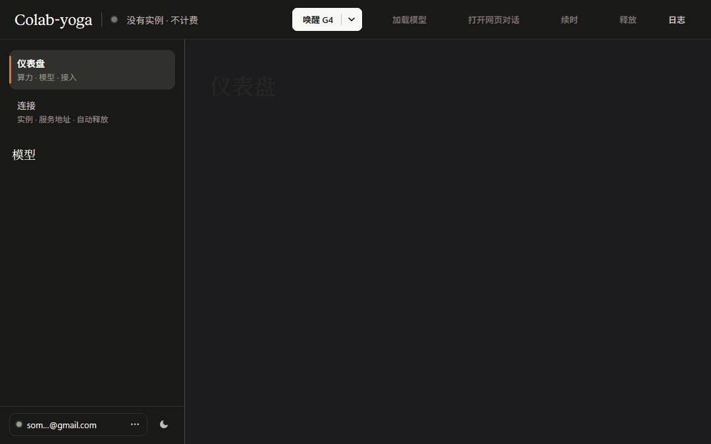
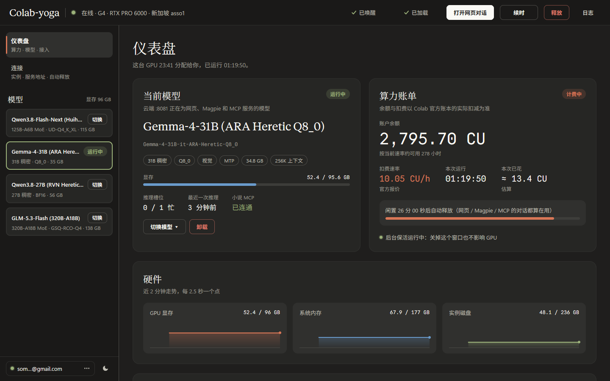
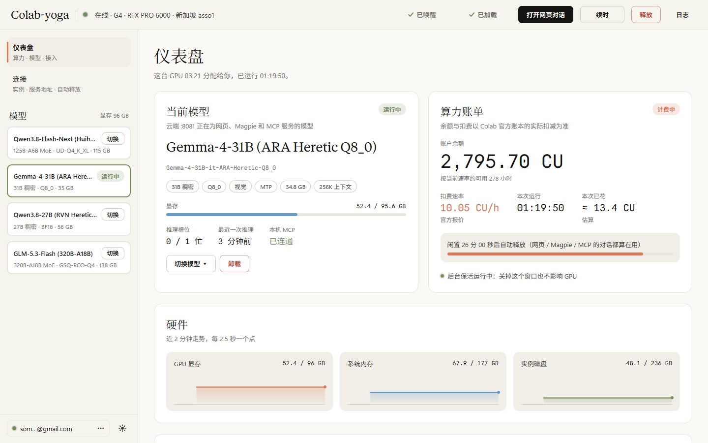
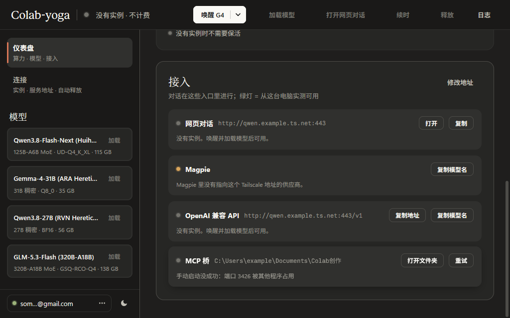

#  Colab-yoga

[简体中文](README.md) | English

[](https://awesomemygo.dev/apps/colab-yoga)

A system tray console for self-hosted LLMs on paid Google Colab GPUs: wake or release the instance in one click, keep an eye on your balance and on whether each endpoint is reachable, and let it shut down on its own when nobody is using it.

Run your own large language models on paid Google Colab GPUs (default: G4 · RTX PRO 6000 96 GB) and expose `llama-server :8081` over Tailscale to web chat, Magpie, and the local MCP bridge. Chat traffic does not pass through Colab-yoga; Colab-yoga only manages the GPU: how much it costs, which model is running, whether each entrypoint is reachable, keeping the instance alive while in use, and releasing it automatically when idle.



| Dark theme (default) | Light theme (Oklab crossfade) |
|---|---|
|  |  |

The model runtime itself (`colab_kernel` startup script, model catalog, Chinese thinking-template patches, and local MCP service) lives in the `colab-gpu-llm-service` repository, not here. The console's model list is whatever the exported `colab_kernel_runners.json` holds, so models you add yourself show up too.

## Implemented features

- GPU and models: wake, load and switch models, extend, release, independent keepalive, and idle shutdown.
- Status and usage: balance, burn rate, VRAM, inference slots, and connectivity for web chat, API, Magpie, and local MCP.
- Local MCP: automatic start on wake, recovery checks every 60 seconds while a GPU session is active, and safe shutdown when the last session ends.
- Manual fallback: the MCP card's **Start** button also works with no GPU. It runs in the background, prevents duplicate clicks, and shows failures with a retry action, using the existing components and motion.
- Native UI: system tray, dark and light palettes, spring motion, press feedback, reduced motion, and no redraws while idle.

## Components

| Directory | Runs on | Role |
|---|---|---|
| `console/` | Local machine | `Colab-yoga.exe` (Windows) / `Colab-yoga.app` (macOS): native UI built with Go + [MyGo](https://github.com/egoist/mygo), resident in the system tray / menu bar |
| `bridge/` | Local machine | `colab_yoga_bridge.py`: Google account auth, wake, endpoint discovery, release, and background keepalive (`keeper`) |
| `server/` | Colab VM | `colab_yoga_server.py`: HTTP API, idle watchdog, and MCP forwarding; `vm_boot.py`: executed inside the VM kernel on wake |
| `tools/` | Local machine | `install.py`: checks, build, runtime and dependency setup, installation, shortcuts, and config migration; `package.py`: builds the portable release zip |

Conventions shared across components (directory layout, APIs, state fields, and keepalive rules) are documented in [docs/architecture.md](docs/architecture.md).

## Getting started (first model in 4 steps)

1. **Sign in**: unzip the portable package, run `Colab-yoga.exe` (Windows) or open `Colab-yoga.app` (macOS), and sign in with your Google account.
2. **Set up Tailscale**: configure a Tailscale Service once, as described in colab-gpu-llm-service; web chat, the API and MCP all use that address.
3. **Export the model list**: clone [colab-gpu-llm-service](https://github.com/incredible404-rgb/colab-gpu-llm-service), fill in the 4 required fields of `.secrets.json` (`api_key`, `ts_client_id`, `ts_client_secret`, `tailnet_fqdn`), and run `python -X utf8 scripts/colab_kernel.py --all` (`python3` on macOS). It writes `%LOCALAPPDATA%\Colab-yoga\colab_kernel_runners.json` (`~/Library/Application Support/Colab-yoga/colab_kernel_runners.json` on macOS) automatically, and the console lists the models right away.
4. **Use it**: back in the console, click **Wake G4**, load a model, then chat on the web or call the `/v1` API.

Without colab-gpu-llm-service, Colab-yoga still signs in, wakes, keeps alive and releases instances on its own; there are just no models to load.

## Deployment

Two ways, and neither depends on another application's install directory: Colab-yoga brings its own Python runtime and dependencies. Supports **Windows 10/11 x64** and **macOS Apple Silicon (`darwin-arm64`)**.

### Option 1: download the portable package

1. Download `Colab-yoga-<version>-windows-amd64.zip` or `Colab-yoga-<version>-darwin-arm64.zip` (with its `.sha256` next to it) from [Releases](https://github.com/incredible404-rgb/Colab-yoga/releases).
2. Unzip it anywhere and run `Colab-yoga.exe` (Windows) or open `Colab-yoga.app` (macOS; if Gatekeeper blocks a browser download, run `xattr -cr Colab-yoga` once). No separate Python install is needed. The whole folder can be moved as a unit; do not take `Colab-yoga.exe` / `Colab-yoga.app` out of it on its own.
3. Settings and state live in `%LOCALAPPDATA%\Colab-yoga` (Windows) or `~/Library/Application Support/Colab-yoga` (macOS), not in the unzipped folder. The package creates no shortcuts and writes nothing to the registry; delete the folder to uninstall.
4. The model list `colab_kernel_runners.json` (exported by colab-gpu-llm-service's `colab_kernel.py`, contains API keys) and the local MCP config `local_mcp_bridge.json` are both written to that config directory by default, and the console reads them from there, so the package works from any folder with no files to copy by hand; a file of the same name next to the app binary takes precedence. The package ships neither; without a model list the model library is empty and says how to export one.

### Option 2: install from source

- **Windows 10/11 x64**: [Go](https://go.dev/dl/) 1.27+; [PowerShell 7](https://learn.microsoft.com/powershell/scripting/install/installing-powershell-on-windows) (`pwsh`, used for shortcuts and process handling); and [python.org](https://www.python.org/downloads/windows/) Python 3.10+ with pip.
- **macOS Apple Silicon (`arm64`)**: [Go](https://go.dev/dl/) 1.27+ (or `GOTOOLCHAIN=auto`) and `python3` (the bundled standalone CPython 3.12.10 brings its own `pip`, verified by SHA-256).

```bash
git clone https://github.com/incredible404-rgb/Colab-yoga.git
cd Colab-yoga
# Windows:
py -3 tools/install.py
# macOS:
python3 tools/install.py
```

That one command:

- runs the checks (syntax, `go vet`, Go tests, and the unit tests for bridge and server), then builds `Colab-yoga.exe` / `Colab-yoga.app`;
- downloads a pinned standalone CPython 3.12.10 into `<install>/runtime` (`%LOCALAPPDATA%\Programs\Colab-yoga\runtime` on Windows, `~/Library/Application Support/Programs/Colab-yoga/runtime` on macOS) and verifies its SHA-256; an existing `runtime/` is not downloaded again (offline, point `--embed-zip <file>` at the same archive);
- installs the dependencies into `site-packages/` from [bridge/requirements.txt](bridge/requirements.txt): pinned versions, every wheel hash-checked, binary wheels only, targeting CPython 3.12 (`win_amd64` or `macosx_arm64`);
- places `bridge/` and `server/`, creates shortcuts (Start menu + desktop `.lnk` on Windows, `~/Applications/Colab-yoga.app` symlink on macOS), and smoke-tests the bridge with the bundled runtime.

Running it again is an upgrade: dependencies are not reinstalled when their versions match, and a running console is closed first and reopened afterwards. Add `--dry-run` to see what it would do, or `--root <dir>` to try it elsewhere.

When moving over from the earlier EasyColab, the installer once copies the old `settings.json`, moves the newer `colab_kernel_runners.json` from the old directory into the new install, and then deletes the old compatibility layer in `%LOCALAPPDATA%\Programs\EasyColab` (only when it contains nothing but links, the forwarder script and the exe copy; anything else is left alone).

### Build the portable package yourself

```bash
# Windows:
py -3 tools/package.py --out <a directory outside the repo>
# macOS:
python3 tools/package.py --out <a directory outside the repo>
```

It stages the package the same way an install does, in a temporary directory, zips it to `Colab-yoga-<version>-windows-amd64.zip` or `Colab-yoga-<version>-darwin-arm64.zip` (plus a `.sha256`), and audits the result: no `colab_kernel_runners.json`, `settings.json`, `keeper.json`, token or credential files, `.pyc` files, or key-shaped strings. If anything turns up, the zip is deleted and the build fails.

## Local MCP bridge

The local MCP and Magpie are both optional: when they are not installed or configured, their cards show a quiet note instead of errors.

The local MCP needs `scripts/local_mcp.py` and its neighboring `local_mcp.mjs` from [colab-gpu-llm-service](https://github.com/incredible404-rgb/colab-gpu-llm-service), plus Node.js and Pi; cloud forwarding also needs `local_tailscale_ip` set in the model list. By default the local MCP listens only on `127.0.0.1` and the configured `local_tailscale_ip`, never on the public LAN.

The console looks for `COLAB_LOCAL_MCP_SCRIPT`, the `script` field in `local_mcp_bridge.json` beside the exe, the `script` field in `%LOCALAPPDATA%\Colab-yoga\local_mcp_bridge.json` (written by `colab_kernel.py` on export), then `~/.agents/skills/colab-gpu-llm-service/scripts/local_mcp.py` (also accepting `~/.claude/skills/`). Usually there is nothing to write by hand; to point it somewhere yourself, use:

```json
{"script": "C:/tools/colab-gpu-llm-service/scripts/local_mcp.py"}
```

Wake starts the local bridge automatically and reuses a running instance. If it fails, choose **Start** on the dashboard's MCP card; this works without waking a GPU. Health checks verify the service identity. An unrelated listener on port 3426 is reported as a conflict and is left running. The card turns green only after a cloud-to-PC probe confirms reachability; local readiness, a disconnected cloud or a pending check stays gray. A confirmed release clears cached model/MCP health and rejects late results from probes started before release.

`local_mcp` directly reuses Pi's `read`, `write`, `edit`, and `bash` with the current Windows user's permissions. The working directory is a default, and other accessible paths remain available. Pi session skills, rules, and approval hooks are not loaded by this bridge. Its dedicated Bearer token stays in local `~/.config/colab-cli/local-mcp.json`; configure `Authorization` once in the WebUI's private client MCP settings. Real tokens are excluded from notebooks, runners, and public WebUI defaults. See the service repository for complete setup instructions.



## For agents

[skills/colab-yoga/SKILL.md](skills/colab-yoga/SKILL.md) is a skill for Claude Code, Codex and other agents: install, bind the account, wake / release, read balance and model, switch models; anything that spends money is confirmed with you first. Copy the whole `skills/colab-yoga` folder (it includes `references/api.md`, the server API) into the agent's skills directory (e.g. `~/.claude/skills/` or `~/.agents/skills/`). The portable release zip carries the same folder under `skills\colab-yoga\`. Model deployment itself is covered by the skill that ships with [colab-gpu-llm-service](https://github.com/incredible404-rgb/colab-gpu-llm-service).

## Daily Usage

- Launch **Colab-yoga** from the Start menu or desktop shortcut. Only a single instance runs: launching it again brings the existing window to the front.
- Closing the window hides it to the system tray without affecting the GPU. The tray tooltip shows billing status and current CU balance; the right-click menu provides shortcuts to open web chat, extend time, release the GPU (opens a confirmation prompt first), and quit.
- First-time setup: until a Google account is bound, the window is a sign-in page and nothing else. **Sign in with Google** opens your browser; after authorizing, paste the authorization code back. **Continue without signing in** opens the console anyway: the log and the server address work, while waking and the balance need an account. Once signed in, the account sits at the foot of the left rail, where its menu switches accounts, refreshes the balance, or signs out. The token is shared with colab-gpu-llm-service (`~/.config/colab-cli/token.json`), so if an account is already bound there is nothing to bind; authorizing the same account again leaves the running sessions alone.
- The steps of a session are in the top bar, left to right: **Wake G4** (its arrow picks another GPU) → **Load model** → **Open web chat** → **Keep alive** → **Release**. Only the next step is a filled button; a step that is done stays in place, dimmed and ticked; a button that cannot be used now is gray and says why under the pointer. The first click on **Load model** opens the library with the model loaded last time chosen, and a second click on the same button loads it; choose another in the list first to load that one instead. A wake and a model load show their progress stage by stage in the dashboard's **Current model** card; a failed wake stops at the stage that failed and says why.
- The access address (the Tailscale Service host) is picked up from the scripts in the model list file (`SERVICE_FQDN` first, then any `*.ts.net` host). If it cannot be recognized, enter it by hand under **Connection → Access addresses**.
- Instance keepalive is handled by an independent `keeper` process, so closing or exiting the console does not interrupt a running GPU; a command-line `bridge wake` also starts the keeper itself once the server is up. The server's full status and control calls (load, unload, idle timer, release) need a random Bearer token that wake delivers and stores in `%LOCALAPPDATA%\Colab-yoga\server_token.json`; the console attaches it automatically. Only `GET /health` exposes minimal public health fields; full `/api/status` and logs require the token. If a local update remains connected to an older cloud server, use **Redeploy** to update the server too; the next wake deploys a matching version automatically. The cloud watchdog counts activity across web chat, Magpie, and MCP as active usage, releasing the instance only after the configured idle timeout (default: 30 minutes), with a system notification 5 minutes before release.

## Development

The source can live anywhere. Requires Go 1.27+ (the MyGo CLI version is pinned in `console/go.mod`).

```bash
# Run all checks: AST, go vet, go test, and unit tests for bridge and server (prepares the runtime, dependencies and the server test venv on first run)
py -3 tools/install.py --check
# Check, build, install locally, and reopen the running console
py -3 tools/install.py
```

Once installed you can also run the installer with the bundled runtime: `runtime/python.exe -X utf8 tools/install.py` (it has no pip of its own, so this only works while the dependencies are already in place).

- Visual snapshot self-check: `cd console && SNAP_DIR=<dir> go test -run Snapshots` outputs PNG snapshots across dark/light themes, window sizes, and UI states.
- README animation: `cd console && FRAMES_DIR=<dir> go test -run ReadmeFrames` writes the frames of one whole session (wake, load a model, switch theme); assembled, they are `docs/motion.gif`.
- Motion lives in `console/motion.go`: movement rides springs (a second click mid-flight turns with its velocity), colors and opacity ease on short curves, and movement jumps to its place when the desktop asks for less motion. Cards rise into place without fading in: on the GPU a large area whose opacity animates flickers frame to frame, plainly so on the dark theme. Pulses and shimmers run only during wake, release, model load and inference; an idle window draws no frames (guarded by `TestIdleWindowIsStill`). Mid-animation screenshots: `cd console && SNAP_DIR=<dir> go test -run MotionSnapshots`.
- Icons: `cd console && go run ./cmd/makeicon` renders `resources/icon.png` and `tray.png` using MyGo's canvas API.
- Changes under `server/` take effect on the next wake or via **Redeploy Server** on the **Connection** page, which reuses the running VM without interrupting the model or MCP forwarding on `:8081`.

## License

Apache License 2.0. See [LICENSE](LICENSE) and [NOTICE](NOTICE).
