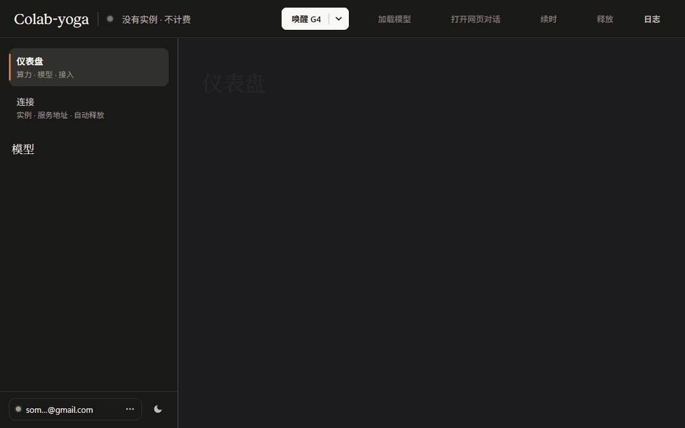
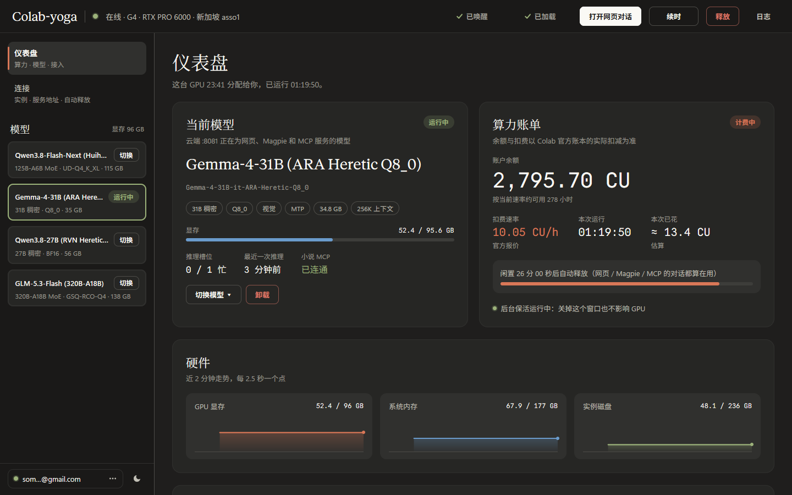
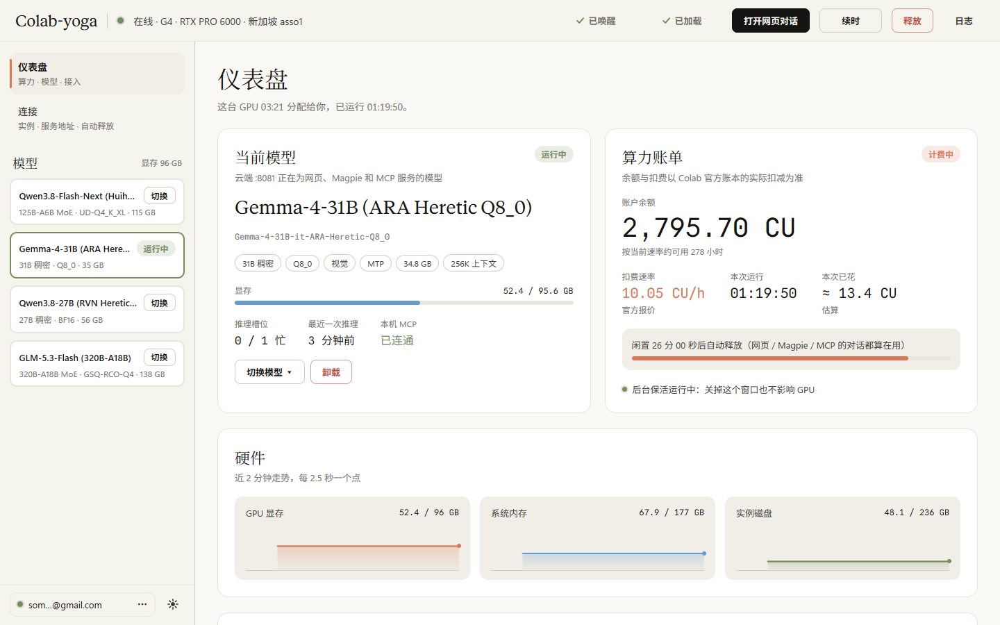

#  Colab-yoga

中文 | [English](README.en.md)

常驻系统托盘的 Colab GPU 管理台：一键唤醒、释放 Google Colab 付费 GPU 上的大模型实例，随时查看余额和各入口是否连通，没人用时自动关停。

在 Google Colab 付费 GPU（默认 G4 · RTX PRO 6000 96 GB）上跑自己的大模型，并通过 Tailscale 把 llama-server :8081 提供给网页对话、Magpie 和 MCP 小说目录桥。对话不经过 Colab-yoga，它只负责管理 GPU：花了多少钱、跑的是哪个模型、每个入口通不通，以及让实例在有人用时一直活着、没人用时自动释放。



| 深色模式（默认） | 浅色模式（Oklab 平滑切换） |
|---|---|
|  |  |

模型本身（colab_kernel 启动脚本、模型清单、中文思考补丁、小说 MCP 服务）在 colab-gpu-llm-service 项目里，不在这个仓库。管理台的模型列表就是导出的 `colab_kernel_runners.json` 里有什么就列什么，自己加的模型也会出现。

## 组成

| 目录 | 运行在 | 作用 |
|---|---|---|
| `console/` | 本机 | `Colab-yoga.exe`：Go + [MyGo](https://github.com/egoist/mygo) 原生界面，常驻托盘 |
| `bridge/` | 本机 | `colab_yoga_bridge.py`：Google 账号、唤醒、找回地址、释放、后台保活（keeper） |
| `server/` | Colab VM | `colab_yoga_server.py`：HTTP API、闲置看门狗、MCP 转发；`vm_boot.py`：唤醒时在 VM 内核里执行 |
| `tools/` | 本机 | `install.py`：检查、构建、准备运行时与依赖、安装、快捷方式、配置迁移；`package.py`：打免安装包 |

各部分之间的约定（目录布局、API、状态字段、保活规则）见 [docs/architecture.md](docs/architecture.md)。

## 部署

两种方式，都不依赖任何别的软件的安装目录；运行时的 Python 和依赖由 Colab-yoga 自己带。

### 方式一：下载免安装包

1. 在 [Releases](https://github.com/incredible404-rgb/Colab-yoga/releases) 下载 `Colab-yoga-<版本>-windows-amd64.zip`（旁边有 `.sha256`）。
2. 解压到任意位置，运行里面的 `Colab-yoga.exe`。不需要另外安装 Python；整个文件夹可以整体移动，但不要把 exe 单独拿出去。
3. 设置和状态保存在 `%LOCALAPPDATA%\Colab-yoga`，不在解压目录里。免安装包不建快捷方式、不写注册表，删掉文件夹即卸载。
4. 要看到并切换模型，需要把 `colab_kernel_runners.json`（colab-gpu-llm-service 的 `colab_kernel.py` 导出，含 API 密钥）放在 `Colab-yoga.exe` 旁边。包里不带这个文件；没有它，管理台的模型列表是空的，并提示去导出。

### 方式二：从源码安装

前置：Windows 10/11 x64；[Go](https://go.dev/dl/) 1.27+；[PowerShell 7](https://learn.microsoft.com/powershell/scripting/install/installing-powershell-on-windows)（`pwsh`，建快捷方式和管理进程用）；[python.org](https://www.python.org/downloads/windows/) 的 Python 3.10 或更新（要带 pip，只用来跑安装脚本和 pip；管理台运行时用的 3.12 由安装脚本另外下载）。

```bash
git clone https://github.com/incredible404-rgb/Colab-yoga.git
cd Colab-yoga
py -3 tools/install.py
```

这一条命令会：

- 检查（语法、`go vet`、Go 测试、bridge 与 server 的单测），再构建 `Colab-yoga.exe`；
- 下载 python.org 的 Windows 嵌入式 CPython 3.12.10 到 `%LOCALAPPDATA%\Programs\Colab-yoga\runtime`，校验 SHA-256；已有 `runtime\` 时不重复下载（离线时用 `--embed-zip <文件>` 指向同一个压缩包）；
- 用宿主 Python 的 pip，按 [bridge/requirements.txt](bridge/requirements.txt) 把依赖装进 `site-packages\`：版本锁定、逐个 wheel 校验哈希、只装二进制包，目标固定为 CPython 3.12 / win_amd64，所以宿主 Python 不必是 3.12（不用 uv）；
- 放好 `bridge\`、`server\`，建开始菜单和桌面快捷方式，并用自带的运行时做一次 bridge 自检。

重复运行就是升级：依赖版本没变就不会重新安装，正在运行的管理台会先关掉、装完再打开。想先看会做什么：加 `--dry-run`；想在别处试一遍：`--root <目录>`。

从早先的 EasyColab 迁移时，安装脚本会一次性把旧的 `settings.json` 复制过来，把旧目录里较新的 `colab_kernel_runners.json` 迁到新安装目录，再删掉 `%LOCALAPPDATA%\Programs\EasyColab` 里的旧兼容层（目录里只有联接、转发脚本、exe 副本时才会删，其他情况原样保留）。

### 自己打免安装包

```bash
py -3 tools/package.py --out <仓库之外的目录>
```

按安装同样的流程在临时目录里组好，压成 `Colab-yoga-<版本>-windows-amd64.zip`（同目录有 `.sha256`），并审计内容：不含 `colab_kernel_runners.json`、`settings.json`、`keeper.json`、token 或凭据类文件、`.pyc`、密钥特征字符串，发现就删掉 zip 并报错。

## 给 agent 用

[skills/colab-yoga/SKILL.md](skills/colab-yoga/SKILL.md) 是给 Claude Code、Codex 等 agent 的技能：安装、绑定账号、唤醒 / 释放、查余额与模型、切换模型，花钱的动作会先向你确认。把 `skills/colab-yoga` 整个文件夹复制到 agent 的技能目录（如 `~/.claude/skills/` 或 `~/.agents/skills/`）即可；模型本身的部署见 [colab-gpu-llm-service](https://github.com/incredible404-rgb/colab-gpu-llm-service) 自带的技能。

## 日常使用

- 开始菜单或桌面上的「Colab-yoga」。只会运行一个实例：再次打开时，会把已在运行的窗口调出来。
- 关窗口会缩到托盘，GPU 不受影响。托盘图标的提示里显示是否在计费和当前余额；右键菜单可以打开网页对话、续时、释放（会先打开窗口确认）、退出。
- 第一次使用：在「连接与账号」页绑定 Google 账号。点「绑定」后会打开浏览器，授权后把页面上的授权码粘贴回来。令牌与 colab-gpu-llm-service 共用（`~/.config/colab-cli/token.json`），已经绑定过就不用再绑；同一个账号重新授权不会动正在运行的会话。
- 接入地址（Tailscale Service 域名）会从模型清单的脚本里自动识别（先找 `SERVICE_FQDN`，再找任意 `*.ts.net` 域名）；识别不到就在「连接与账号 → 接入地址」里手填。
- 实例保活由独立的 keeper 进程负责，关掉或退出管理台都不影响；只用命令行 `bridge wake` 唤醒时，wake 成功后也会自己把 keeper 拉起来。服务端的控制接口（加载、卸载、改闲置时间、释放）要带随机生成的 Bearer 令牌，由唤醒时下发并保存在 `%LOCALAPPDATA%\Colab-yoga\server_token.json`，只有 `GET /api/status` 不需要。云端看门狗把网页、Magpie、MCP 里的对话都算作在用，闲置到设定时间（默认 30 分钟）才会释放实例；剩 5 分钟时会弹系统通知。

## 开发

源码放在哪里都行。需要 Go 1.27+（MyGo CLI 已在 `console/go.mod` 里固定版本）。

```bash
# 全部检查：AST、go vet、go test、bridge 和 server 的单测（运行时、依赖和 server 测试的 venv 第一次会自动准备）
py -3 tools/install.py --check
# 检查、构建、安装到本机，并重新打开正在运行的管理台
py -3 tools/install.py
```

装好之后，也可以直接用安装目录里的运行时跑：`runtime/python.exe -X utf8 tools/install.py`（它自己没有 pip，只在依赖已经就位时可用）。

- 截图自检：`cd console && SNAP_DIR=<目录> go test -run Snapshots`，会输出深色、浅色、多种尺寸、各种状态的 PNG。
- 动效：都在 `console/motion.go`。位移走弹簧（中途再点会顺着原速度转向），颜色和透明度走短曲线，系统开了「减少动画」时位移直接到位；脉冲和流光只在唤醒、释放、装载、推理时出现，静止时窗口不画帧（`TestIdleWindowIsStill` 守着）。动画中间帧截图：`cd console && SNAP_DIR=<目录> go test -run MotionSnapshots`。
- 图标：`cd console && go run ./cmd/makeicon`，用 MyGo 的画笔生成 `resources/icon.png` 和 `tray.png`。
- 改了 `server/` 要重新唤醒才会生效：在「连接与账号」页点「重新部署服务端」，会复用同一台机器，:8081 上的模型和 MCP 转发都不会中断。

## 许可

Apache License 2.0，见 [LICENSE](LICENSE) 和 [NOTICE](NOTICE)。
